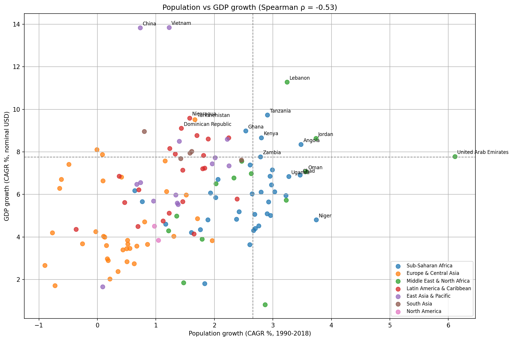
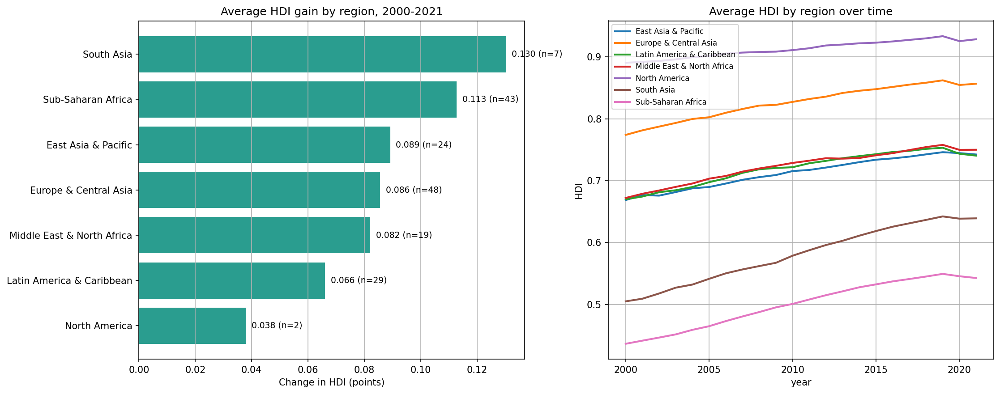
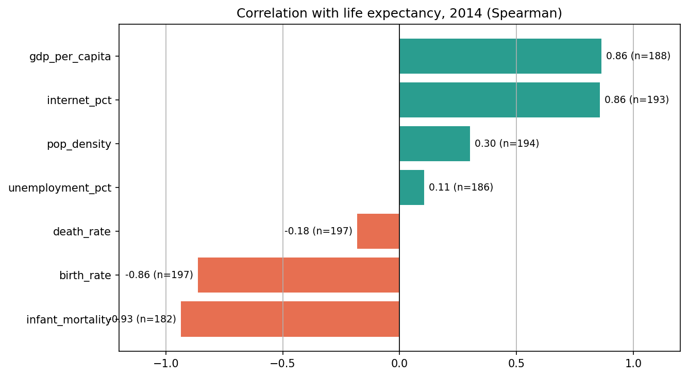
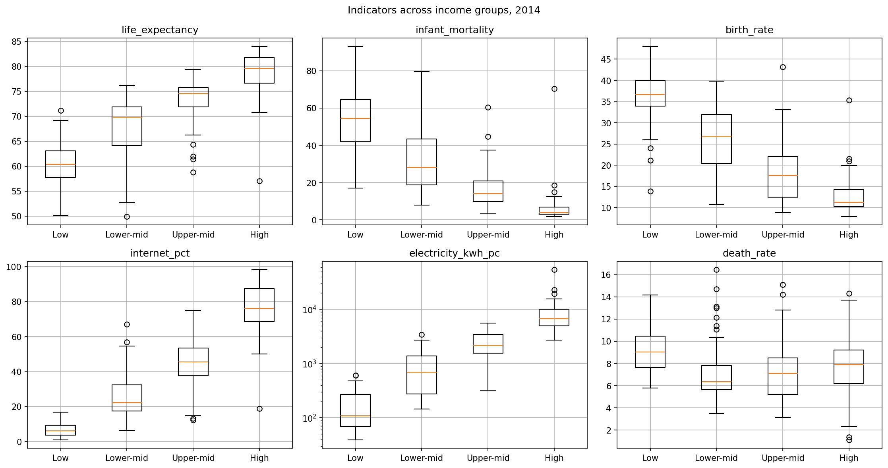

# World Economic Indicators: Growth, Development and Life Expectancy

An exploratory data analysis of World Bank and UN development indicators for about 190 countries, built with **Python (pandas, NumPy, Matplotlib)** in Google Colab.

---

## Executive Summary

Using World Bank indicators (1960-2018) and UN Human Development Index (HDI) data (1990-2021), this project finds that fast population growth and fast GDP growth rarely coincide: only Jordan and Lebanon rank in the top 15 for both between 1990 and 2018, the rank correlation is weak and unstable (ρ = 0.37 for 1990-2018, falling to 0.13 over 1980-2018), and faster population growth went with slightly *slower* income growth per person (ρ = -0.21). South Asia (+0.130 HDI points) and Sub-Saharan Africa (+0.113) gained the most HDI between 2000 and 2021, but most of that is catch-up from low starting points (ρ = -0.53), and after adjusting for it, regional differences shrink to about ±0.02. Life expectancy is most strongly correlated with infant mortality, internet use, birth rate, GDP per capita and electricity use (|ρ| = 0.80-0.94 in 2014), though these overlap heavily and mostly reflect one overall development dimension. The same five indicators almost perfectly separate High from Low income countries (for example, median infant mortality of 3.9 vs 54.5 per 1,000), while unemployment, death rate and population density do not. All findings are correlations and descriptive comparisons, not causal claims.

## Business Questions

1. Which countries have experienced the highest growth in population and GDP? Is there overlap?
2. Which regions saw the most growth in HDI in the 21st century?
3. Which factors are highly correlated with life expectancy?
4. Which factors differentiate "High income" from "Low income" countries?

## Data

| Source | Coverage | Content |
|---|---|---|
| World Bank | 1960-2018, 211 countries and territories (12,449 rows) | Birth and death rates, electricity use, GDP, GDP per capita, internet use, infant mortality, life expectancy, population density, unemployment; region and income group |
| UN Development Programme (HDI) | 1990-2021, 195 countries after cleaning | HDI and 37 related indicators (stored in wide format, one column per indicator and year) |

Dataset: [World Economic Indicators, Maven Analytics Data Playground](https://mavenanalytics.io/data-playground/world-economic-indicators) (free login to download).

## Tools

Python 3, pandas, NumPy, Matplotlib, SciPy (used for a significance test), Google Colab.

## Methods

| Question | Method |
|---|---|
| Q1 | Compound annual growth rate (CAGR) for population and GDP, 1990-2018; top-15 lists; overlap in the top quintile tested against chance (hypergeometric test); Spearman correlation; robustness checks across time windows and with 3-year averages; population growth cross-checked against population density |
| Q2 | HDI change 2000-2021 by World Bank region (mean, median, % change, and a 2019 end-point that excludes the COVID dip); catch-up analysis (starting HDI vs gain) and a gain-versus-expected adjustment |
| Q3 | Spearman and Pearson correlations with life expectancy (2014); within-income-group correlations; stability across 1995-2014 |
| Q4 | Median comparison across income groups; rank-based separation score (AUC) for High vs Low income; stability across 2000, 2010 and 2014 |

## Key Findings

### Q1: Population and GDP growth (1990-2018)
- **Population grew fastest** in the UAE (6.1% a year), Niger, Jordan, Oman and Angola. Ten of the top 15 are in Sub-Saharan Africa and five in the Middle East and North Africa.
- **GDP (USD) grew fastest** in Vietnam (13.9% a year), China, Lebanon, Tanzania and Nicaragua, a more geographically mixed group.
- **Overlap is limited and unstable.** Only Jordan and Lebanon are in both top-15 lists (Angola joins them using 3-year averages). The rank correlation is ρ = 0.37 across 128 countries, falling to 0.23 for 2000-2018 and 0.13 for 1980-2018. Seven countries are in the top quintile of both measures against 5.1 expected by chance (p = 0.25).
- **Faster population growth did not mean faster income growth per person:** ρ = -0.21 between population growth and GDP per capita growth, unchanged when population growth was measured from population density (agreement with the derived population series: ρ = 0.999).
- The fastest per-capita growers (China, Vietnam, plus post-communist economies such as Poland and Romania) mostly had slow population growth.

### Q2: HDI growth by region (2000-2021)
| Region | Countries | Avg HDI gain | Gain vs expected from starting level |
|---|---|---|---|
| South Asia | 7 | +0.130 | +0.02 |
| Sub-Saharan Africa | 43 | +0.113 | 0.00 |
| East Asia & Pacific | 24 | +0.089 | 0.00 |
| Europe & Central Asia | 48 | +0.086 | +0.01 |
| Middle East & North Africa | 19 | +0.082 | 0.00 |
| Latin America & Caribbean | 29 | +0.066 | -0.02 |
| North America | 2 | +0.038 | -0.02 |

- South Asia and Sub-Saharan Africa ranked first and second under every measure tested; the bottom two regions were also stable.
- **Most of this is catch-up:** starting HDI and gain are strongly negatively correlated (ρ = -0.53). After adjusting, Sub-Saharan Africa's advantage disappears, South Asia keeps a small edge, and Latin America & Caribbean falls slightly short.
- The largest individual gains were Ethiopia, Angola, Rwanda, China and Bangladesh. Syria, Yemen and Libya had almost no gain, which pulls down the Middle East & North Africa average.

### Q3: Correlates of life expectancy (2014)
| Factor | Spearman ρ |
|---|---|
| Infant mortality | -0.94 |
| Internet use | +0.87 |
| Birth rate | -0.86 |
| GDP per capita | +0.85 |
| Electricity use | +0.80 |
| Population density | +0.31 |
| Death rate | -0.23 |
| Unemployment | +0.13 |

- The strong correlations are stable from 1995 to 2014, except internet use (which rose as adoption spread) and the death rate (which weakened from -0.60 to -0.23).
- The strong factors overlap heavily (for example, internet use and GDP per capita correlate about 0.9 with each other, and infant mortality and birth rate also about 0.9, in the 2015 check), so they largely measure one overall development dimension.
- Infant mortality is partly built into life expectancy at birth, so that correlation is partly definitional.

### Q4: High vs Low income countries (2014)
| Indicator | Low income (median) | High income (median) | Separation score |
|---|---|---|---|
| Electricity (kWh per capita) | 109 | 6,720 | 1.00 |
| Internet use (%) | 6.2 | 76.0 | 1.00 |
| Life expectancy (years) | 60.3 | 79.6 | 0.99 |
| Infant mortality (per 1,000) | 54.5 | 3.9 | 0.99 |
| Birth rate (per 1,000) | 36.6 | 11.3 | 0.99 |
| Unemployment (%) | 3.6 | 7.0 | 0.75 |
| Death rate (per 1,000) | 9.0 | 7.9 | 0.66 |
| Population density | 64 | 130 | 0.61 |

*Separation score: 0.5 = no separation, 1.0 = perfect.*

- The top five separate the groups almost perfectly, rise in a steady gradient across all four income groups, and kept scores of 0.98-1.00 in 2000, 2010 and 2014.
- Unemployment is higher in high income countries, probably reflecting how it is measured (many people in low income countries work informally). The death rate's separation weakened from 0.93 (2000) to 0.66 (2014), likely because rich countries have older populations.
- GDP per capita also separates the groups perfectly but is excluded as **circular**: income groups are defined by income.
- Electricity use rests on only 13 low income countries.

## Data Cleaning Log

| Step | Issue | Decision |
|---|---|---|
| 1 | Long, inconsistent column names | Renamed to short snake_case names. |
| 2 | Structure of the World Bank table | 12,449 rows = 211 countries x 59 years; no duplicate country-year rows; region and income group constant within each country; no aggregate rows (e.g. "World") found. |
| 3 | Heavy missingness (internet 59%, unemployment 58%, electricity 53%, GDP 23%) | **Not imputed or dropped.** Missingness reflects when indicators began being tracked, so each question uses a year or window with adequate coverage. |
| 4 | No population column in the World Bank table | Derived `population = GDP / GDP per capita`; validated against known values and against population growth implied by population density (ρ = 0.999). |
| 5 | HDI table in wide format (206 rows x 1,008 columns) | Removed 11 aggregate rows, reshaped from wide to long, then pivoted to one row per country-year: 195 countries x 32 years. |
| 6 | Country mismatches between sources | 19 World Bank-only codes are territories (e.g. Puerto Rico, Bermuda, Guam) with no HDI; 3 HDI-only countries (Micronesia, Laos, Nauru) are absent from the World Bank table. Merged on ISO3 code and year with a left join: 192 matched countries. |
| 7 | "High income" split into OECD and non-OECD | Combined into one High income group for Q4. |
| 8 | Different year coverage (1960-2018 vs 1990-2021) | Analyses that combine both sources use 1990-2018; Q2 uses HDI alone (2000-2021). |
| 9 | Electricity data ends in 2014 | Q3 and Q4 use 2014, the latest year with all indicators. |

## Limitations

- **Correlation is not causation.** Every result is an association or a descriptive comparison.
- **GDP is in [nominal / constant: check the data dictionary] USD.** If nominal, growth rankings include inflation and exchange-rate effects, and statistical rebasings can affect some countries.
- **Derived population.** It is estimated as GDP / GDP per capita (validated against density), and is missing wherever GDP is missing.
- **Base-year effects.** 1990 values for post-communist and war-affected economies are unusually low, which inflates their growth; 3-year averaging did not remove this.
- **Population growth is not just births.** Gulf and Levant countries (UAE, Oman, Jordan) have large migration inflows.
- **Coverage.** Q1 excludes countries with missing data or under 1 million people in 1990 (128 of 211 remain). Q2 covers 172 of 192 matched countries; the 20 missing include Nigeria and several conflict-affected states, which could bias some regional averages. Laos and Micronesia could not be analysed with the economic indicators.
- **Small groups.** South Asia (7 countries) and North America (2) in the HDI analysis; electricity data for only 13 low income countries.
- **Fixed income labels.** Income groups are a single classification applied to every year, so earlier-year comparisons use today's classification.
- **Unweighted averages.** Regional averages treat every country equally regardless of population.
- **Overlapping indicators and a built-in link.** The factors in Q3 and Q4 are strongly correlated with each other, and infant mortality is partly part of life expectancy at birth.
- **Single-year snapshots.** Q3 and Q4 use 2014 (checked against other years), and may differ for more recent years.

